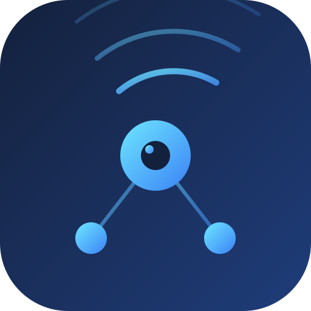
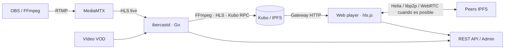

# IberCast

<p align="center">
  
</p>

**Plataforma experimental de streaming VOD y en directo sobre IPFS, con reproductor web HLS y recuperación P2P.**

IberCast combina un daemon en Go, Kubo/IPFS, FFmpeg, MediaMTX y un reproductor TypeScript basado en hls.js y Helia. El objetivo es publicar vídeo como contenido direccionado por contenido y permitir que el navegador intente recuperar bloques desde la red P2P, con fallback HTTP cuando no haya peers disponibles.

> **Estado:** prototipo funcional en desarrollo. El repositorio contiene el daemon, el reproductor, el stack local y pruebas automatizadas. No debe interpretarse como un servicio de producción auditado ni como una garantía de distribución P2P en todos los navegadores o redes.

## Capacidades implementadas

- **VOD:** API de subida, transcodificación HLS con FFmpeg y publicación en Kubo/IPFS.
- **Reproductor web:** TypeScript, hls.js y Helia, con loader personalizado y fallback a gateway HTTP.
- **Directos:** ingestión RTMP mediante MediaMTX, HLS de baja latencia y monitorización del estado del stream.
- **Panel y API:** gestión de canales y operaciones de administración.
- **Operación:** lanzador local `run.sh`, configuración por flags/variables de entorno y workflow de GitHub Actions.
- **Verificación:** typecheck/build del player, vet/build/tests del daemon y harness E2E para el DAG HLS; el modo navegador es opcional.

## Arquitectura



### Componentes

| Componente | Responsabilidad |
|---|---|
| `ibercastd/` | API HTTP, ingestión/transcodificación, publicación IPFS, persistencia y gestión de directos |
| `player/` | Interfaz web, wall/viewer/admin y loader HLS con Helia |
| `run.sh` | Arranque coordinado del entorno de desarrollo |
| `scripts/e2e.mjs` | Comprueba el DAG HLS por HTTP y, opcionalmente, reproducción en navegador |
| `.github/workflows/ci.yml` | Typecheck/build del player y vet/build/tests del daemon |

## Requisitos

- Go **1.26** (según `ibercastd/go.mod`)
- Node.js 20 o superior y npm
- FFmpeg
- Kubo/IPFS, si se prueba publicación VOD o recuperación mediante gateway
- MediaMTX, si se prueban emisiones en directo
- OBS Studio o FFmpeg como emisor RTMP, para pruebas live

El reproductor puede ejecutarse por separado; Kubo y MediaMTX solo son necesarios para los flujos que los utilizan.

## Inicio rápido

El script de desarrollo coordina MediaMTX, Kubo, el daemon y Vite. Revisa primero sus requisitos y opciones:

```bash
git clone https://github.com/aratan/IberCast.git
cd IberCast
chmod +x run.sh
./run.sh
```

Opciones útiles del lanzador:

```bash
./run.sh --no-live       # no iniciar MediaMTX
./run.sh --no-ipfs       # no iniciar Kubo
./run.sh --no-player     # no iniciar Vite
./run.sh --daemon-only   # alias de --no-player
```

Para compilar y ejecutar solo el daemon:

```bash
cd ibercastd
go test ./...
go build -o ibercastd .
./ibercastd serve --port 8585
```

Para el reproductor:

```bash
cd player
npm ci
npm run typecheck
npm run build
npm run dev
```

La configuración del daemon admite flags y variables de entorno. Los valores por defecto y opciones disponibles están definidos en `ibercastd/internal/config/config.go`.

## Verificación

Desde la raíz del repositorio:

```bash
# Daemon Go
cd ibercastd
go vet ./...
go test ./...
go build ./...
cd ..

# Player
cd player
npm ci
npm run typecheck
npm run build
cd ..

# E2E: resolver manifiesto, playlists y segmentos desde un gateway
node scripts/e2e.mjs --gw https://gateway.pinata.cloud --max-segments 5

# E2E con navegador (requiere Chrome compatible con H.264/AAC)
node scripts/e2e.mjs --browser --max-segments 5
```

El harness E2E distingue dos niveles: la fase HTTP comprueba la resolución del DAG HLS; `--browser` añade comprobaciones de reproducción y metadata en Chromium/Chrome. Una prueba contra un fixture público no sustituye una prueba completa de publicación VOD o de emisión live con infraestructura propia.

El workflow de CI está en [`.github/workflows/ci.yml`](.github/workflows/ci.yml). Consulta la pestaña Actions para ver el resultado del último commit; la existencia del workflow no implica por sí sola que una ejecución haya pasado.

## Configuración importante: gateway IPFS

El código del proyecto espera por defecto el gateway HTTP de Kubo en `http://127.0.0.1:8080`. Comprueba la configuración local:

```bash
ipfs config Addresses.Gateway
```

El API RPC de Kubo usa por defecto `http://localhost:5001`. Son endpoints distintos: RPC para operaciones de publicación y gateway HTTP para recuperar contenido.

## Seguridad y despliegue

- No expongas el API RPC de Kubo (`:5001`) a Internet.
- Configura autenticación de administración antes de exponer el daemon. Usa `--auth-enabled` o `--admin-token`; guarda los secretos fuera del repositorio.
- Cuando se inicializa un administrador, el daemon muestra una contraseña temporal por consola y exige cambio de contraseña. Trátala como un secreto.
- Revisa CORS, TLS, límites de subida, almacenamiento, rate limits y reglas de red antes de desplegar públicamente.
- El pinning local no garantiza disponibilidad si el nodo se apaga. Para persistencia externa se necesita un proveedor de pinning remoto o nodos propios adicionales.
- El proyecto no incluye DRM ni garantiza protección contra copia del contenido.

## Documentación

- [Arquitectura](docs/architecture.md)
- [Flujo de desarrollo y verificación](docs/workflow.md)
- [Workflow CI](.github/workflows/ci.yml)

## Licencia

Aún no se ha definido una licencia. El uso y la redistribución deben acordarse antes de considerar el proyecto como software de código abierto.
