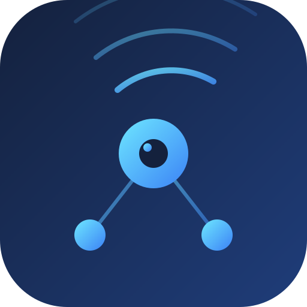

# IberCast

<p align="center">
  
</p>

**Streaming de vídeo P2P sobre IPFS.** El vídeo se fragmenta en HLS y se
distribuye entre los propios espectadores: cada navegador que reproduce
actúa a la vez como nodo que sirve fragmentos a otros, reduciendo el coste
de banda ancha del origin a cambios de eficiencia de red.

---

## Objetivos

1. **Distribución P2P real** — los viewers aportan ancho de banda vía
   WebRTC; el origin solo siembra los bloques raíz y los manifiestos.
2. **Coste ~cero de origin** — apoyarse en gateways IPFS públicos o propios
   en vez de CDNs de pago.
3. **Resiliencia por diseño** — sin punto único de fallo: el contenido
   sobrevive mientras haya al menos un nodo con los bloques.
4. **Censura-resistencia** (opcional/futuro) — sin coordenador central que
   pueda apagar la emisión.
5. **Privacidad del espectador** — sin cuentas, tracking mínimo, métricas
   agregadas en el cliente.

## Alcance (MVP)

- VOD: subir un vídeo → transcodificar a HLS → publicar en IPFS como CAR
  → reproducir desde el navegador por P2P.
- Live streaming: ingest RTMP/WebRTC → MediaMTX → HLS corto (ventanas 4–6 s)
  → proxy same-origin en `ibercastd` → reproducción en el navegador
  (sin CORS, un solo puerto público).
- Fuera de alcance por ahora: chat en vivo, DRM, transcodificación en el
  navegador.

## Stack elegido (híbrido Go + TypeScript)

| Capa | Tecnología | Motivo |
|---|---|---|
| Nodo / seed backend | **Go** + `libp2p` / `go-ipfs-api` (Kubo RPC) | Madurez del ecosistema IPFS, goroutines para cientos de conexiones simultáneas, bajo consumo de memoria en seeders |
| Ingest en vivo | **MediaMTX** (RTMP :1935) | Estándar de facto para emisores (OBS, ffmpeg); empaqueta a HLS corto |
| Transcodificación | **FFmpeg** → HLS (`.m3u8` + segmentos `.ts`/`.m4s`) | Estándar de facto; los segmentos son bloques IPFS naturales |
| Cliente / reproductor | **TypeScript** + **Helia** (JS-IPFS en navegador) + **WebRTC** | Los navegadores se convierten en nodos P2P sin plugins |
| Reproducción | **hls.js** con loader personalizado | Permite interceptar cada petición de segmento y resolverla primero vía IPFS/WebRTC, cayendo al gateway HTTP como último recurso |

### Por qué híbrido y no solo un lenguaje

- La infraestructura P2P pesada (seed nodes, publicación CAR, coordinación
  de swarms) vive mejor en Go junto a Kubo/libp2p.
- El P2P de navegador (WebRTC data channels + Helia) solo existe en
  JS/TS; es el núcleo del modelo de coste cero.

## Arquitectura (MVP)

```
            ┌──────────────┐   HLS segments (CAR)   ┌─────────────────┐
 vídeo ──►  │  ibercastd   │ ─────────────────────► │  IPFS network   │
 (input)    │  (Go seed)   │   manifest root CID    │  (Kubo / Helia) │
            └──────────────┘                        └────────┬────────┘
                      ▲                                      │ bitswap
                      │ admin API (publicar, listar)         ▼
                      │                             ┌─────────────────┐
        operador ─────┘                             │  web player     │
                                                    │  TS + Helia +   │
                                                    │  hls.js (P2P)   │
                                                    └─────────────────┘
```

- **`ibercastd`** (Go): transcodifica con FFmpeg, empaqueta a CAR, publica
  en IPFS, sirve API admin/REST para subir y listar canales, e ingesta en
  vivo: valida `streamKey`, marca un stream como `live` cuando MediaMTX
  reporta el path activo (poller 5 s) y sirve HLS con proxy same-origin.
- **`player`** (TS): reproductor embebible; loader de hls.js que pregunta
  primero a la swarm P2P (Helia + WebRTC) y hace fallback a gateway HTTP.
  Vista `wall` para el grid de canales en vivo.

## Roadmap

### Fase 0 — Fundaciones
- [x] Repo, git init y estructura de carpetas.
- [x] Documentación de arquitectura y flujos (docs/, con diagramas Mermaid).
- [x] CI básica (GitHub Actions: typecheck + build player; daemon en guard).

### Fase 1 — Pipeline VOD
- [x] CLI/API `ibercastd`: subir vídeo → HLS con FFmpeg (3 calidades).
- [x] Empaquetado de la salida HLS a CAR y publicación en IPFS (Kubo RPC).
- [x] Endpoint que devuelve el CID raíz del manifiesto.
- [x] Miniatura (`thumb.jpg`) generada al publicar y pineada con el manifiesto.

### Fase 2 — Reproductor P2P *(scaffold listo, build verificado)*
- [x] `player` en TS con Helia (navegador) + bitswap.
- [x] Loader custom de hls.js: resolver segmentos por path UnixFS.
- [x] Fallback transparente a gateway HTTP si P2P no responde a tiempo.
- [x] Métricas: segmentos/bytes servidos por P2P vs gateway vs caché.
- [x] Verificación E2E con un vídeo publicado por `ibercastd` (publicar → gateway → hls.js).

### Fase 3 — Producción
- [x] Seed nodes con proved plumbing (systemd/docker).
- [x] Pinning remoto (Pinata/web3.storage o Kubo cluster propio).
- [x] Live streaming con HLS corto (ventanas de 4–6 s) + modo evento.
- [x] Autenticación de operador y multi-tenant.

## ⚠️ Gateway de IPFS: debe estar en el puerto 8080

Todo el código asume que el gateway HTTP de Kubo escucha en **8080**
(`player/src/gateway.ts`, `internal/config/config.go`, `run.sh`, `deploy/`).
Si lo mueves a otro puerto, **los vídeos no se ven**: el player pide los
manifiestos y segmentos a `http://{cid}.ipfs.localhost:8080` y recibe
`ERR_CONNECTION_REFUSED`.

```bash
# Comprobar
ipfs config Addresses.Gateway   # debe ser /ip4/127.0.0.1/tcp/8080

# Restaurar si está movido (cambia la config global de IPFS, fuera del repo)
ipfs config Addresses.Gateway /ip4/127.0.0.1/tcp/8080
ipfs shutdown && ipfs daemon    # el gateway solo cambia al reiniciar
```

Este ajuste **no está en git** (vive en `~/.ipfs/config`), así que no se
comparte entre máquinas: hay que verificarlo también en el VPS.

Diagnóstico rápido si no reproducen:

```bash
ipfs config Addresses.Gateway
curl -s -o /dev/null -w "%{http_code}\n" http://127.0.0.1:8080/ipfs/<CID>/master.m3u8
```

### Vídeos antiguos con rutas de segmento rotas

Los vídeos publicados **antes** del arreglo de `ingest.go` tienen playlists
variantes con el prefijo duplicado (`/v0/index.m3u8` →
`v0/seg-000.ts` → HLS pide `/v0/v0/seg-000.ts` → 404). El código actual ya lo
genera bien; **hay que volver a subir esos vídeos**.

## Documentación

- [docs/architecture.md](docs/architecture.md) — arquitectura del sistema,
  flujos de publicación y reproducción, diagramas (Mermaid), ADRs.
- [docs/workflow.md](docs/workflow.md) — flujo de trabajo de desarrollo,
  verificación E2E y CI.

## Estructura del repo

```
IberCast/
├── ibercastd/        # daemon Go: ingest, HLS, IPFS publish, API (Fase 1)
├── player/           # cliente TS: Helia + hls.js loader P2P (Fase 2)
├── scripts/          # e2e.mjs: verificación contra fixtures públicos
├── docs/             # arquitectura y flujos de trabajo
└── .github/          # CI (typecheck+build player, go test daemon)
```

## Cómo probar

```bash
# 1. Arranca Kubo local (gateway en 8080 — ver aviso arriba)
ipfs daemon

# 2. Publica un vídeo
cd ibercastd && go build -o ibercastd .
./ibercastd serve --port 8585

# En otra terminal, sube un vídeo:
curl -X POST http://localhost:8585/api/videos \
  -F "title=My Video" \
  -F "file=@video.mp4"

# 3. Sirve el player
cd player && npm run dev
# abre http://localhost:5173/?mode=viewer&api=http://localhost:8585
```

## Pinning remoto

Para que el contenido sea accesible incluso si el nodo local se apaga, usa pinning remoto:

```bash
# 1. Registrar un servicio de pinning
ipfs pin remote service add pinata https://api.pinata.cloud <JWT>
ipfs pin remote service add filebase https://api.filebase.io <TOKEN>

# 2. Pinrear un CID publicado
node scripts/pin-remote.mjs --cid <CID> --service pinata --name "video-1"
```

Servicios compatibles (plan free sin tarjeta):
- **Pinata**: 1 GB gratis, https://api.pinata.cloud
- **Filebase**: 5 GB gratis, https://api.filebase.io
- **Storacha**: 5 GB gratis, https://api.web3.storage

## Licencia

Por decidir (MIT o Apache-2.0).

## Estado

🚧 Pre-lanzamiento — README y roadmap vivos, código por llegar.

> Estado real: `ibercastd` + `player` + MediaMTX funcionando con live
> streaming local (OBS/ffmpeg → RTMP → HLS → wall/player) y VOD; repo
> subido a GitHub (github.com/aratan/IberCast). Roadmap de arriba se
> actualiza contra el código en cada fase.
