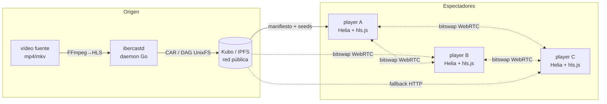
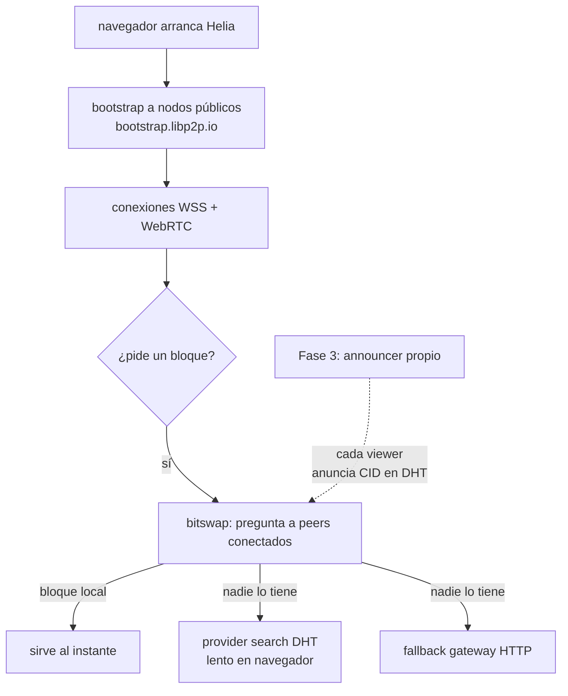

# IberCast — Arquitectura

> Documentación viva. Última actualización: 2026-09-04.

## 1. Visión general

IberCast es un sistema de **streaming de vídeo P2P sobre IPFS**. El vídeo se
fragmenta en HLS y se publica como un DAG de UnixFS en la red IPFS. Los
espectadores lo reproducen desde un navegador que es, a la vez, un nodo IPFS
(Helia): pide los bloques por bitswap a otros peers y cae a un gateway HTTP
solo como último recurso.



La línea discontinua es tráfico P2P real: cuantos más espectadores, menos
carga sobre el gateway de origen.

## 2. Componentes

| Componente | Repo/lang | Estado | Responsabilidad |
|---|---|---|---|
| `ibercastd` | Go | 📋 diseñado (Fase 1) | Ingest: transcodificar a HLS, empaquetar a CAR, publicar en IPFS, API admin |
| `player` | TypeScript | ✅ scaffold con build verde (Fase 2) | Reproducir cualquier CID publicado; loader P2P-first con fallback a gateway |
| `docs/` | Markdown | ✅ | Arquitectura, flujos y decisiones |
| `scripts/e2e.mjs` | Node | 🧪 en curso | Verificación E2E contra fixtures públicos |

### 2.1 ibercastd (Go) — diseño

Un único binario sin dependencias de runtime (FFmpeg debe existir en el PATH).

```
ibercastd/
├── main.go              # CLI: ibercastd publish|serve
├── internal/
│   ├── config/          # flags + defaults (ladder de calidades, timeouts)
│   ├── ingest/          # ffprobe + FFmpeg → ladder HLS (v0/v1/v2) + master.m3u8
│   ├── ipfsapi/         # cliente RPC de Kubo: AddDir, DagExport, Pin, IsUp
│   ├── publish/         # orquesta ingest → CAR → Kubo → devuelve CID raíz
│   ├── server/          # API HTTP admin (publish, list, healthz)
│   └── store/           # registro persistente de canales publicados
```

### 2.2 player (TypeScript) — implementado

```
player/src/
├── node.ts    # nodo Helia: WebRTC + WebSockets + circuit-relay, noise/yamux
├── loader.ts  # Loader custom de hls.js: caché → P2P → gateway
└── main.ts    # UI, HUD de métricas, hooks E2E (window.__IBER__)
```

## 3. Flujo de publicación (Fase 1)

```mermaid
sequenceDiagram
    autonumber
    actor Op as Operador
    D as ibercastd
    F as FFmpeg
    K as Kubo (RPC)
    N as Red IPFS

    Op->>D: POST /publish {vídeo, título}
    D->>F: ffprobe (duración, resolución, streams)
    F-->>D: metadatos
    D->>F: ladder HLS 3 calidades<br/>(v0 1080p, v1 720p, v2 480p)<br/>segmentos fMP4/TS 4–6 s
    F-->>D: out/{master.m3u8, v0/, v1/, v2/}
    D->>D: empaqueta salida a CAR<br/>(DAG UnixFS determinista)
    D->>K: /api/v0/add (dir, CIDv1 raw-leaves)
    K-->>D: CID raíz
    D->>K: /api/v0/pin/add
    D->>K: /api/v0/dag/export (opcional, respaldo)
    D-->>Op: {rootCID, manifiesto, tamaños}
    Note over N: con el CID, cualquier nodo<br/>puede servir y replicar el DAG
```

### 3.1 Contrato de layout dentro del CID raíz

Este layout es el **contrato** entre `ibercastd` y el `player`:

```
<rootCID>/
├── master.m3u8          # manifiesto maestro (#EXT-X-STREAM-INF → vN/index.m3u8)
├── v0/index.m3u8        # calidad alta
│   └── v0/seg-XXXX.m4s  # segmentos (rutas RELATIVAS, nunca URL absolutas)
├── v1/index.m3u8
└── v2/index.m3u8
```

> ⚠️ Las playlists deben usar rutas relativas. Si un gateway reescribe URLs
> absolutas, el mapeo P2P del loader se rompe. `ibercastd` genera playlists
> propias para garantizarlo.

## 4. Flujo de reproducción (implementado en player)

```mermaid
sequenceDiagram
    autonumber
    actor U as Usuario
    H as hls.js
    L as IberLoader (custom)
    C as caché en memoria
    P as Helia (browser)
    G as Gateway HTTP

    U->>H: play(?cid=...)
    H->>L: load(/ipfs/<cid>/master.m3u8)
    L->>C: ¿está en caché?
    alt cache miss
        L->>P: unixfs.cat(rootCID, path)
        alt P2P ok (peers > 0)
            P-->>L: bytes por bitswap/WebRTC
        else P2P falla / sin peers
            L->>G: GET /ipfs/<cid>/master.m3u8
            G-->>L: bytes
        end
    end
    L-->>H: manifiesto
    H->>L: load(/ipfs/<cid>/vN/seg-XXXX.m4s) × cada segmento
    Note over L: misma resolución: caché → P2P → gateway
    L-->>H: segmentos
    H->>U: reproducción + métricas HUD<br/>(bytes P2P vs gateway vs caché)
```

### 4.1 Reglas de resolución del loader

1. **Caché** (`Map<ruta, bytes>`): re-servir lo ya bajado (base para
   re-emisión a otros viewers en Fase 3).
2. **P2P** (solo si `peerCount() > 0`): `unixfs.cat(rootCID, { path })` con
   timeout de 8 s. Sin peers conectados se salta directamente al gateway para
   no pagar timeouts de búsqueda de proveedores en cada segmento.
3. **Gateway HTTP** (`?gw=`, por defecto `ipfs.io`, timeout 20 s): el
   resultado entra en caché, de modo que los reintentos y el resto de la
   sesión reutilizan esos bytes.

### 4.2 Hooks E2E

`window.__IBER__` expone estado para verificación automatizada:
`status`, `ready`, `hlsError`, `fetchStats`, `levels`, `videoW/H`, `duration`.

## 5. Descubrimiento de peers (hoy y en Fase 3)



Hoy el player solo pregunta a los peers con los que ya tiene conexión, por
eso el hit-rate P2P depende de que `ibercastd` corra un seed node bien
conectado (Fase 1/3). El announcer propio eliminará la dependencia del DHT
público.

## 6. Decisiones de diseño (ADRs resumidos)

| # | Decisión | Motivo |
|---|---|---|
| 1 | HLS + fMP4/TS segmentado | estándar universal, segmentos = bloques IPFS naturales |
| 2 | UnixFS con paths relativos | permite `cat(cid, {path})` sin resolver enlaces |
| 3 | CIDv1 raw-leaves en publicación | gateways modernos y deduplicación mejor |
| 4 | Go para el daemon, TS para el player | Kubo/libp2p maduros en Go; Helia/WebRTC solo existen en browser-JS |
| 5 | Gateway como fallback, no como origen | el coste de banda debe caer en la swarm, no en un CDN |
| 6 | `enableWorker: false` en hls.js | el loader custom aún no es transferable a worker |
