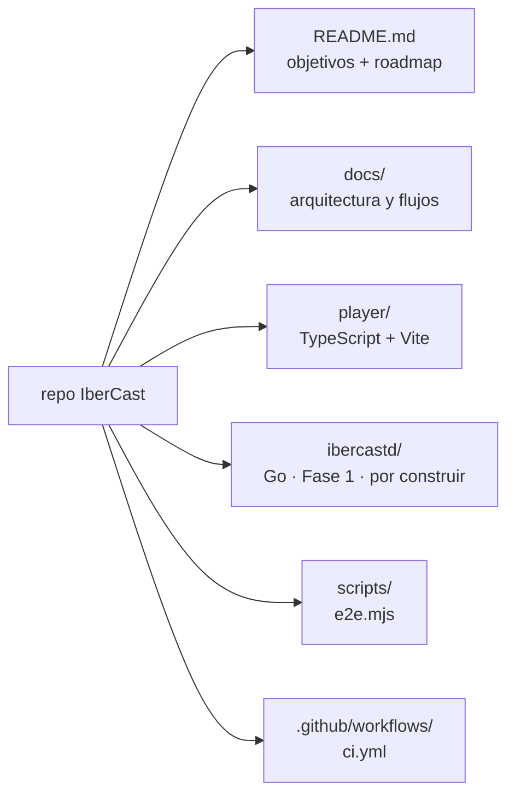
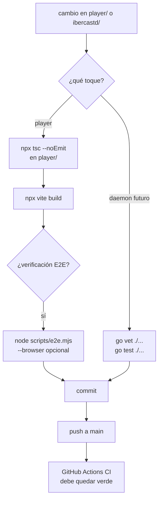
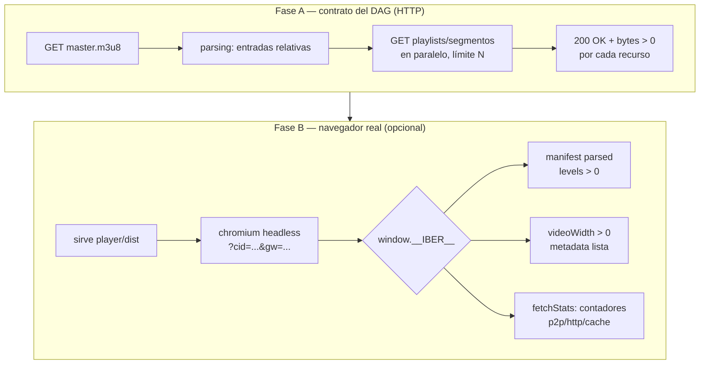
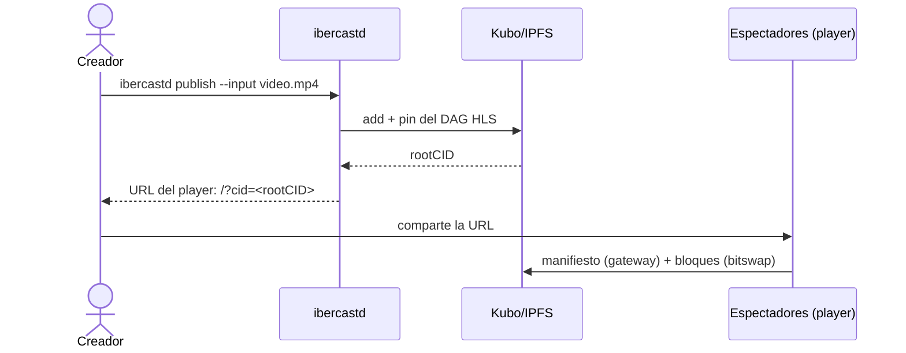

# IberCast — Flujo de trabajo

> Cómo se desarrolla, se verifica y se publica IberCast.
> Complemento operativo de [architecture.md](architecture.md).

## 1. Mapa del repositorio



## 2. Ciclo de desarrollo



Comandos rápidos:

```bash
# player
cd player && npm install
npx tsc --noEmit && npx vite build

# E2E fase A (DAG por gateway, con límite de segmentos)
node scripts/e2e.mjs --gw https://ipfs.io --max-segments 5

# E2E con navegador headless (si hay chromium disponible)
node scripts/e2e.mjs --browser --max-segments 5

# daemon (cuando exista)
cd ibercastd && go vet ./... && go test ./...
```

## 3. E2E: qué se verifica



Fixtures públicos de referencia (Big Buck Bunny, playlists planas):

- `QmdpAidwAsBGptFB3b6A9Pyi5coEbgjHrL3K2Qrsutmj9K` — vía [ipfsvideo.cc](https://ipfsvideo.cc)
- El gateway debe devolver CORS `*`. En la práctica: `ipfs.io`/`dweb.link`
  comparten infra y aplican 429 por IP; `gateway.pinata.cloud` es fiable.

Requisitos de la Fase B (aprendidos a las malas):

1. **Navegador con codecs propietarios**: Chrome for Testing / branded
   Chrome. El chromium open-source de Playwright no decodifica H.264/AAC
   (falla con `fragParsingError`).
2. **`--host-resolver-rules` con IPv4**: si el entorno tiene IPv6 roto,
   chromium muere donde curl hace fallback; el harness mapea los hosts a
   sus A-records vía DNS al arrancar.
3. **Helia puede no arrancar** en sandboxes (WSS bootstrap a dnsaddr sin
   A-records cuelga). El player degrada a solo-gateway y el E2E lo acepta.

Estado actual (2026-09-04): **E2E OK en verde** — reproducción real vía
loader custom (caché → P2P condicionado a peers → XhrLoader gateway),
video 320×180, 596 s, sin errores HLS.

## 4. CI (GitHub Actions)

| Job | Disparo | Pasos |
|---|---|---|
| `player` | push/PR | npm ci → `tsc --noEmit` → `vite build` |
| `daemon` | push/PR | (se activa cuando exista `ibercastd/go.mod`) go vet → go build → go test |

El job del daemon queda definido en `.github/workflows/ci.yml` con un guard
`if: hashFiles('ibercastd/go.mod') != ''` para no fallar hasta que exista.

## 5. Flujo de publicación de contenido (uso final, Fase 1)



## 6. Convenciones

- **Commits:** mensaje en inglés, imperativo, cuerpo explicando el porqué.
- **Rutas en playlists:** siempre relativas (contrato del loader, ver
  [architecture.md §3.1](architecture.md)).
- **Secrets:** nunca en el repo; `.env` está gitignoreado.
- **Ramas:** trabajo directo en `main` mientras el equipo es pequeño; PR en
  cuanto haya más de un contributor.
